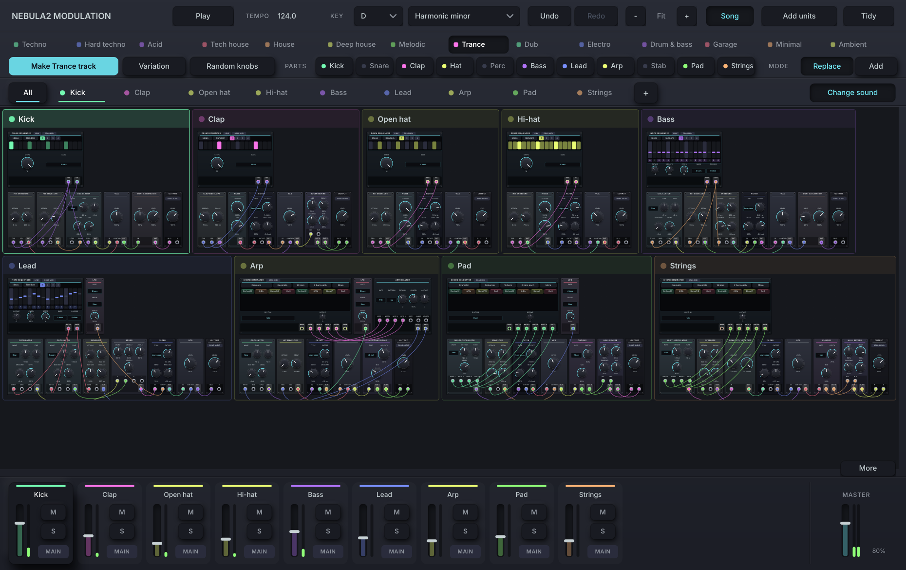
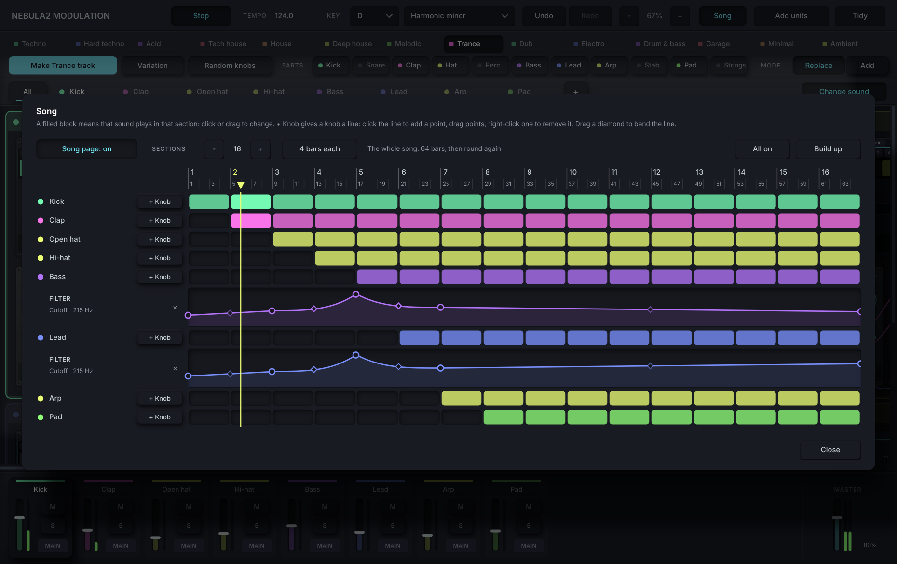
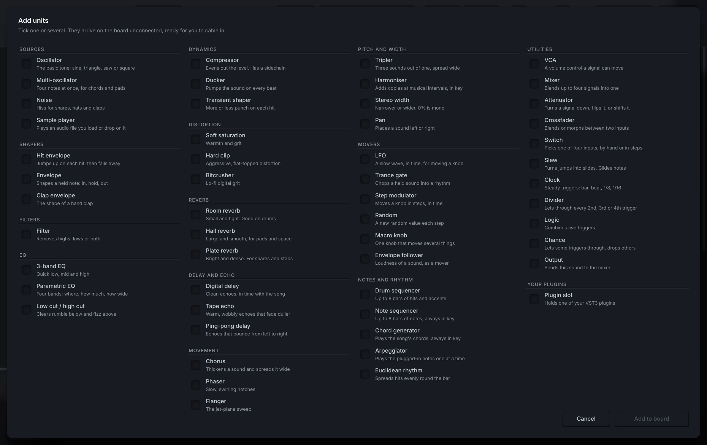
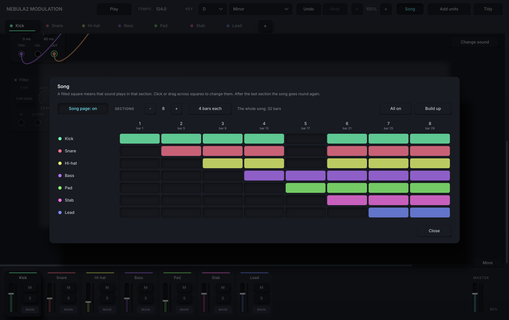

# Nebula2 Modulation

A modular synth for Cubase. Pick a style and press one button for a whole track: every sound built, cabled and
playing. Every sound has its own rack of modules and cables and a pattern to play it. See them all on one board or
one at a time, move knobs through the song on a timeline, and mix on the desk underneath.











This is an early build: styles, the rack, the sound modules, effects, chords, plugin slots, the timeline and the first set of sounds. What's planned next is in
[docs/BUILD-PLAN.md](docs/BUILD-PLAN.md); the full design is in [docs/SPEC.md](docs/SPEC.md).

## Install

**Windows:** unzip and copy `Nebula2 Modulation.vst3` into `C:\Program Files\Common Files\VST3`.

**Mac:** unzip and copy `Nebula2 Modulation.vst3` into `~/Library/Audio/Plug-Ins/VST3`. The plugin isn't signed
by Apple yet, so if Cubase won't load it, open Terminal and run:

```
xattr -cr ~/Library/Audio/Plug-Ins/VST3/"Nebula2 Modulation.vst3"
```

Then rescan plugins in Cubase. Downloads are on the [Releases page](https://github.com/Joenebula/Nebula2-Modulation/releases).

## How to use it

1. Add Nebula2 Modulation as an **instrument track** in Cubase and press play. It follows Cubase's tempo.
   **Play** in the plugin runs it on its own when Cubase is stopped.
2. **A whole track in one go:** click a style in the row under the top bar (Techno, Acid, House, Trance ...), then
   press **Make ... track**. Every sound of that style is built, cabled and playing, with chords to match.
   Press it again for a different one. **Variation** keeps the sounds and makes new patterns. **Random knobs**
   nudges every sound-shaping knob a little (tuning, levels and switches stay put). The **Parts** chips make one
   sound again (Kick, Bass, Pad ...), keeping its mixer channel. **Mode** chooses whether these replace what is
   there or add to it. Each press is one step of Undo.
3. **All** (first in the tab row) shows every sound on one board, each in its own frame, fitted to the window.
   Everything works there as on a tab: knobs, cables, dragging. **-** and **+** zoom in and out (20% to 150%);
   click the zoom figure to fit everything in again. Click a sound to select it for Add units, Change sound and
   Tidy. Double-click a sound's name, or click its tab, to see it alone.
4. Each **tab** is one sound. Click a tab to see only that sound's modules. **Full screen** (right of the tab row)
   makes the plugin's window fill your monitor, and **Focus** hides the style bar and mixing desk so the board gets the room. **Change sound** (right of the tab row)
   swaps it for another preset, a sample, a plugin or one of your saved sounds, and the pattern keeps playing.
5. **+** adds a sound: kick, snare, clap, hi-hat, percussion, bass, lead, arp, stab, pad, strings, sample, or an empty board.
   It arrives cabled and playing.
6. **Add units** opens the menu of modules: sound sources, envelopes, filters, EQ, distortion, reverb, delay, chorus,
   phaser, flanger and more. Tick one or several and they land on the board, unconnected.
7. **Cables:** drag from an output jack (coloured ring) to an input jack. Pull a plug out of an input to move it,
   or drop it on nothing to remove it. Right-click a module to disconnect or delete it.
8. A module marked **not connected** has no path to the Output, so it can't be heard yet.
9. **Patterns:** click steps to edit. **Ideas** gives ready-made patterns for that kind of sound; **Random**
   makes a new one in the same style. Set **Bars** to 2, 4 or 8 for a longer pattern, and use the numbered
   buttons to move between bars.
10. **Chords:** the **Chord generator** (on the Pad and Stab tabs) holds the song's chords. Pick a **Mood**, press
   **Generate**, and choose the song length and how long each chord lasts. Click any chord to change its colour,
   bass note or length, swap it for another chord of the key, or lock it so Generate leaves it alone. **More** has a key change that lifts the last part of the song. There is one set of chords for the
   whole song. A Note sequencer set to **Follow** moves its notes with the chords, so the bass and lead keep up.
11. **Key** at the top is shared by every tab. Notes and chords are always in key.
12. **Your own plugins:** add a **Plugin slot** from Add units (under Your plugins), press **Load** and browse to
    a .vst3, pick one from **All installed plugins**, or drop a .vst3 file on the board. Plugins you've loaded before are listed first under Load. **Open** shows
    the plugin's own window beside the board; close that window when you're done. Cable a sequencer's Pitch and Gate into the slot to
    play an instrument, cable audio into In L / In R to use an effect, and cable Out L / Out R on to the Output.
    **Presets** lists the plugin's own presets, when it has a list, and the **<** and **>** arrows beside it step
    through them one at a time. A plugin that keeps its sounds in its own browser (Nexus, HALion) gives no list:
    press **Open** and choose in its window.
    **Knobs** points the slot's Knob 1 to 4 at the plugin's own controls; cable an LFO or any mover into Mod 1 to 4
    to move them. **+ > Your plugins** does it all in one go: a new tab with Nebula2 Drums, Voice, Chord, Glitch or
    another of your plugins already loaded and cabled.
13. **Links:** to make two sounds move together, link them. On a sequencer, click **LINK** next to its name and pick
    a group. Do the same on another sequencer, on any tab. The second one **follows** the first: it keeps its own
    pattern and moves up and down, in key, as the first one's notes change. The same menu can instead make them
    share the same rhythm, the same notes or both. To link knobs, right-click a knob and pick a group; every knob
    in that group turns together.
14. **Shared effects:** add **Effects (send)** from the + menu: a tab with a reverb fed by bus A. On any other tab, add
    a **Send** unit in the sound's path and turn up Amount. Several tabs can share the one reverb this way.
15. **Separate outputs:** to mix a sound in Cubase's own mixer, click the **MAIN** label on its channel in the mixing
    desk and pick **Out 2** to **Out 16**. In Cubase, switch that output on from the instrument's Activate Outputs
    list. If the label is orange, the output isn't switched on yet and the sound is still in the main mix.
16. **Song:** the **Song** button opens the timeline: bars along the top, a row for each sound. Switch it on, then
    click blocks to choose which sounds play in which section. **Build up** brings one more sound in each section.
    **Moving a knob through the song:** press **+ Knob** on a sound's row and pick a knob (or right-click any knob
    on a board and choose "Move this knob through the song"). It gets a line under its sound. Click the line to
    add a point, drag points up, down and along, right-click a point to remove it. As the song plays the knob
    follows the line, and goes round again after the last bar. The cross at the left takes the line off.
17. **Play it yourself:** add a **MIDI keyboard** unit (under Notes and rhythm) and cable its Pitch and Gate where a
    sequencer's were. It plays from your keyboard or a Cubase MIDI track, and keeps notes in key unless you switch
    that off.
18. **MIDI into Cubase:** drag the **DRAG MIDI** label on a sequencer or the chord unit into the Cubase project.
    **DRAG AUDIO** on a tab's Output does the same with that sound as a WAV file.
19. **Keep a sound:** right-click a tab and choose **Save this sound**. It then appears under **+**, in **Your saved
    sounds**, in every project.
20. The **mixing desk** at the bottom has level, mute and solo for each tab. Click a channel to jump to its tab.
    The **More** tab on its top right edge makes it taller, with longer faders and pan and load for each channel;
    **Less** closes it again.
21. **Tidy** lines the modules up like a rack: rhythm along the top, the sound path underneath, left to right.

**Undo** and **Redo** are at the top (also Ctrl+Z and Ctrl+Y). **-** and **+** zoom the board (also Ctrl + mouse wheel). Hover a row in Add units to see a picture of that unit. To use your own sound, add a **Sample player** and load or drop an audio file on it. Drag the empty board background to move around a big board. Knobs: drag up and down. Hold Shift for fine moves. Double-click to reset. Double-click a tab to rename it;
right-click it to duplicate, move or delete.

## Build it yourself

Needs CMake 3.22+ and a C++17 compiler (Visual Studio 2022 on Windows, Xcode on Mac).

```
git clone --depth 1 --branch 8.0.4 https://github.com/juce-framework/JUCE.git JUCE
cmake -B build
cmake --build build --config Release --target Nebula2Modulation_VST3
```

Tests (no Cubase needed):

```
cmake --build build --config Release --target EngineTest OfflineTest
build/Release/EngineTest
```

The look is the ParaEQ design system, shared with Nebula2 Chord. The Inter fonts are under the SIL Open Font License.
